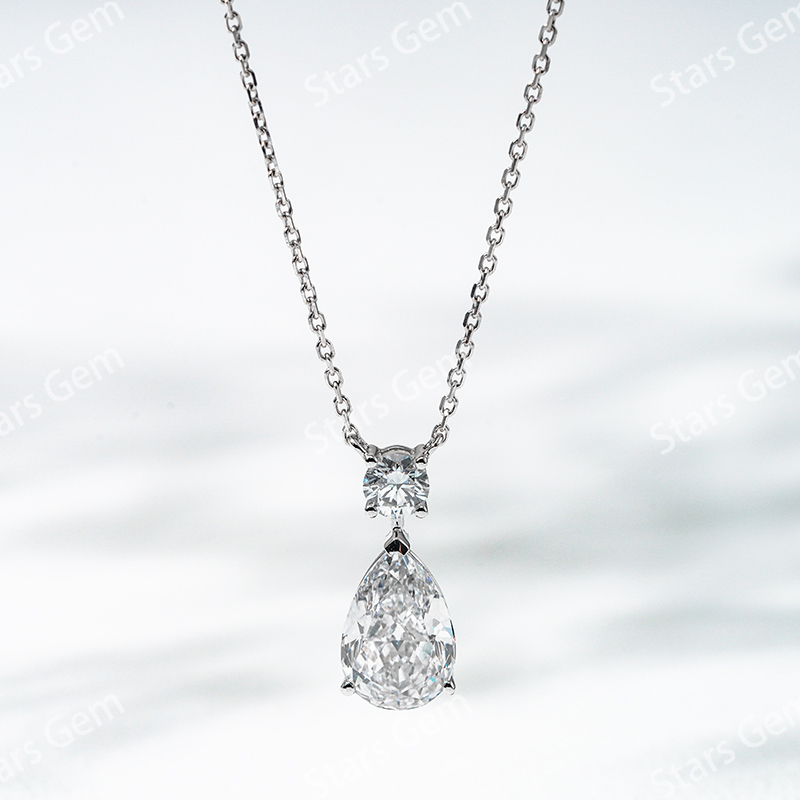

# 09 - StarsGem AUDP0008894 Price Audit

*Compiled 2026-07-29. Prices and specifications are seller-stated unless labeled as calculations. This page is a standalone StarsGem research note; it does not add the SKU to the main comparison dataset.*

## 0. Bottom line

**The $1,413.85 price looks shocking, but it is not obviously out of line with StarsGem's own 18K pricing.** The easily missed point is that the listing contains **2.53 total carats**, not 0.506 ct. StarsGem reports stone weight in grams: **0.506 g × 5 ct/g = 2.53 ct**, exactly matching the listed 2.28 ct pear plus 0.25 ct round. [1]

Compared with StarsGem's closest 18K two-stone necklace, AUDP0008894 costs **2.08× as much while carrying 2.26× the diamond weight**. Its price per total carat is therefore about **8% lower**, not higher. The higher total is primarily a large-stone price: a 2.28 ct pear, a 0.25 ct round, 18K white gold, and a 45+5 cm chain. [1][2]

The parts worth challenging are:

1. **The USD conversion:** ¥8,751.71 converts to about **$1,292.66** at the project comparison rate, roughly $121 below StarsGem's $1,413.85 display. [1][3]
2. **No stated certificate:** the live listing gives no IGI number or certificate status for the 2.28 ct pear.
3. **No construction breakdown:** the chain width, chain-only weight, clasp, pendant weight, and hollow/solid construction are not disclosed.

## 1. Why this page exists

This note answers one narrow question: **why is AUDP0008894 so much more expensive than the other StarsGem necklaces?** It separates unit confusion, diamond size, gold construction, currency conversion, and unsupported quality premiums. It does not add the SKU to the main six-listing table or recommend buying it without an order-specific stone and construction review.

Live listing: [StarsGem AUDP0008894](https://starsgemmall.com/#/detail?=14295_18K+White+Gold+Lab+Diamond+Pendant+Necklace+AUDP0008894.html).



## 2. Verified listing record

The following was verified on the live CNY listing on 2026-07-29. [1]

| Field | Seller-stated value | Research interpretation |
|---|---|---|
| SKU | AUDP0008894 | Two-stone finished necklace |
| Metal | 18K white gold, rhodium plated | Same metal/plating class as the closest 18K comparator |
| Length | 45+5 cm | 5 cm longer than the 40+5 cm comparator |
| Gross product weight | 2.941 g | Includes stones and all metal components |
| Stone weight | 0.506 g | **2.53 ct**, not 0.506 ct |
| Pear | 2.28 ct, 7.0 × 10.4 mm, DEF/VS | More than twice the comparator pear's carat weight |
| Round | 0.25 ct, 4.0 mm, DEF/VS | 2.5× the comparator round's carat weight |
| Total diamond weight | 2.53 ctw | 2.28 + 0.25 ct; agrees exactly with 0.506 g |
| Inferred non-stone mass | 2.435 g | Calculation: 2.941 − 0.506 g; not guaranteed net gold |
| CNY retail / VIP1 | ¥8,751.71 / ¥8,576.67 | Primary pricing figures |
| StarsGem USD retail / VIP1 | $1,413.85 / $1,385.57 | Uses about 6.19 CNY/USD |
| Certificate | None stated | Must not be assumed to include IGI |

## 3. Price audit

### 3.1 The `0.506` field is grams, not carats

This is the main source of confusion. The product table labels its weight unit as grams. Diamond carats convert at **5 carats per gram**:

```text
0.506 g × 5 ct/g = 2.53 ct
2.28 ct pear + 0.25 ct round = 2.53 ct
```

If the listing had only 0.506 ctw, $1,413.85 would look extreme. It does not: it has a 2.28 ct pear plus a 0.25 ct round. [1]

### 3.2 Closest apples-to-apples StarsGem comparison

The best local benchmark is **AuDP4011413(p1)** because it is also an 18K rhodium-plated white-gold, round-over-pear necklace. [2]

| Metric | AUDP0008894 | AuDP4011413(p1) | Difference |
|---|---:|---:|---:|
| Retail USD | $1,413.85 | $680.79 | **2.08×** |
| Retail CNY | ¥8,751.71 | ¥4,214.08 | **2.08×** |
| Total diamond weight | 2.53 ctw | 1.12 ctw | **2.26×** |
| Pear | 2.28 ct | 1.02 ct | **2.24×** |
| Round | 0.25 ct | 0.10 ct | **2.50×** |
| Gross weight | 2.941 g | 2.79 g | **5.4% more** |
| Inferred non-stone mass | 2.435 g | 2.566 g | **5.1% less** |
| Length | 45+5 cm | 40+5 cm | 5 cm longer |
| USD per total carat | $558.83/ctw | $607.85/ctw | **8.1% lower** |

This comparison says two things:

- The price increase tracks the much larger diamonds; it is **not explained by more gold**. Inferred non-stone mass is actually lower despite the longer chain.
- StarsGem is charging slightly less per total carat than on its smaller 18K comparator. Within this seller's catalog, $1,413.85 is expensive in total but not an obvious proportional outlier.

### 3.3 Why the original $410 necklace is a misleading anchor

The original 14K yellow-gold reference costs $410.47 for 1.095 ctw. AUDP0008894 is about 49% more expensive per total carat than that reference. But the reference uses 14K rather than 18K gold, a shorter chain, a 0.935 ct pear rather than a 2.28 ct pear, and no stated certificate. Pear pricing is not guaranteed to scale linearly across the psychologically important 2 ct threshold. [2]

That comparison can justify negotiation; it cannot prove that AUDP0008894 should cost only $800 or $900.

### 3.4 The strongest identifiable overcharge is currency conversion

The live CNY price is ¥8,751.71. StarsGem's USD display implies about **6.19 CNY/USD**. Using the same 6.7703 CNY/USD IMF comparison rate retained in the existing research gives: [2][3]

| Price | StarsGem USD | Analytical USD at 6.7703 | Difference |
|---|---:|---:|---:|
| Retail | $1,413.85 | $1,292.66 | $121.19 |
| VIP1 | $1,385.57 | $1,266.81 | $118.76 |

This is a **9.38% site-conversion uplift** before card/bank spreads, shipping, duty, or payment fees. The analytical conversion is not a guaranteed executable payment quote, but it is strong grounds to request a CNY invoice or a better written USD rate.

## 4. What may still make the price poor value

The catalog arithmetic is internally plausible, but the listing does not prove that the necklace is worth buying at this price.

| Question | Current evidence | Why it matters |
|---|---|---|
| Is the 2.28 ct pear IGI certified? | Unknown; no report number is stated | A large uncertified pear should not receive an unexplained certification premium |
| How well is the pear cut? | DEF/VS seller claim only | Bow-tie, light return, symmetry, and outline can vary materially |
| Is the exact stone shown before purchase? | Not promised in the listing | Prevents substitution and lets the buyer reject a weak pear |
| How much does the chain weigh? | Unknown | The inferred metal mass is lower than the smaller 18K comparator |
| What are the chain dimensions? | Unknown | A 50 cm chain can still be extremely thin |
| Is any component hollow? | Unknown | Gross weight alone does not establish durability |
| Does the price include shipping/duties? | Not stated | Headline price is not landed cost |

## 5. Negotiation position

Do not argue that the necklace is only 0.506 ct. Use the stronger, accurate argument:

> I understand that the 0.506 g stone-weight field equals 2.53 ctw: a 2.28 ct pear plus a 0.25 ct round. Before I accept ¥8,751.71 / $1,413.85, please provide the exact 2.28 ct pear's IGI report number, inscription video, 360° stone video, and measurements. Please also state the chain width, thickness, link dimensions, chain-only weight, pendant weight, clasp, whether any component is hollow, and the guaranteed finished minimum weight. Quote the final total in CNY and USD, state the exchange rate, and itemize shipping, duties, and payment fees. Please also quote the same design in unplated 14K yellow gold.

Practical target:

- Treat **¥8,751.71** as the catalog ceiling, not an automatic fair invoice.
- Challenge the USD display first; the fixed comparison rate implies roughly **$1,293**, before payment costs.
- Do not pay a large-stone premium without an order-specific IGI report and stone video.
- Ask why the inferred non-stone mass is lower than the smaller 18K comparator despite the longer chain.
- Request a 14K yellow-gold version so the desired design is not burdened by 18K white gold and rhodium maintenance.

## Evidence gaps

- No IGI report number or certificate status is stated for either diamond.
- The listing does not disclose growth method, chain gauge, chain-only weight, clasp, pendant weight, hollow/solid construction, shipping, duties, or returns.
- Inferred non-stone mass is gross weight minus diamond weight; it is not a refinery measurement or guaranteed gold weight.
- The 6.7703 comparison rate is retained for consistency with the existing project audit, not represented as a live executable bank rate.
- Catalog price proportionality does not reveal StarsGem's actual diamond, labor, or gold cost.

## Sources

1. StarsGem, AUDP0008894 live listing, accessed 2026-07-29. <https://starsgemmall.com/#/detail?=14295_18K+White+Gold+Lab+Diamond+Pendant+Necklace+AUDP0008894.html> — primary supplier source for 18K white gold, 45+5 cm length, 2.941 g gross weight, 0.506 g stone weight, 2.28 ct pear, 0.25 ct round, and ¥8,751.71 / $1,413.85 retail pricing.
2. Local StarsGem comparison and currency audit, compiled 2026-07-29. [07_starsgem_listing_comparison.md](07_starsgem_listing_comparison.md) — supplies the exact 14K reference and 18K AuDP4011413(p1) comparator specifications, prices, and the established currency method.
3. International Monetary Fund, Representative Exchange Rates for Selected Currencies for July 2026. <https://www.imf.org/external/np/fin/data/rms_mth.aspx?reporttype=rep> — source for the 6.7703 CNY/USD comparison rate used consistently across the project.
4. International Gemological Institute, report lookup. <https://lookup.igi.org/> — official destination for checking any report number StarsGem supplies before purchase.
