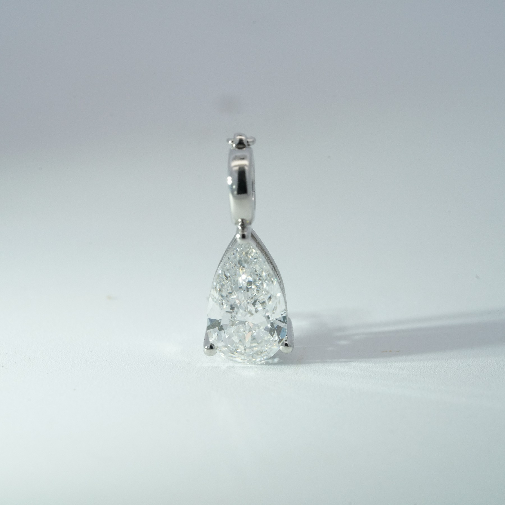

# 10 - StarsGem AuDP1033291-1 Pendant Audit

*Compiled 2026-07-29. Prices and specifications are seller-stated unless labeled as calculations. This is a standalone StarsGem research note; it does not add the SKU to the main comparison dataset or dashboard tabs.*

## 0. Bottom line

**AuDP1033291-1 is one of StarsGem's strongest target-size pear values, but it is a pendant only and the setting is unusually light.** The live listing states a 1.07 ct CVD pear, DEF/VS, 5.3 × 8.9 mm, supplier-stated IGI report **27J056892603**, 10K rhodium-plated white gold, 0.76 g gross weight, and ¥1,522.80 retail. [1]

Against the nearly identical AuDP1033395-2 pendant already in the research, this piece is:

- **1.9% cheaper** in CNY.
- **3.8% larger** by carat.
- More elongated: length-to-width ratio about **1.68 vs 1.52**.
- **18.3% lighter** in gross product weight.
- About **24.6% lighter** in inferred non-stone mass.
- About **5.5% cheaper per carat**. [1][2]

That makes it the better stone-size/price offer on paper, while AuDP1033395-2 appears to have the heavier mounting. The correct choice depends on the exact pear's video and whether StarsGem can prove the bail and prongs are durable enough.

## 1. Why this page exists

This note adds a dedicated StarsGem-only record for AuDP1033291-1 without changing the main six-listing comparison. It answers three questions:

1. What exactly is included?
2. Is it better value than the similar 1.031 ct pendant?
3. What must be verified before treating it as the starting point for a necklace?

Live listing: [StarsGem AuDP1033291-1](https://starsgemmall.com/#/detail?=22975_10K+White+Gold+Lab+Diamond+Pendant+1.07ct+AuDP1033291-1.html).

## 2. Verified listing record

The live StarsGem CNY listing was accessed on 2026-07-29. It initially returned the storefront's temporary `FAILED / ¥0` state, then loaded the complete product record after one reload. The values below come from the completed record. [1]

| Field | Seller-stated value | Research interpretation |
|---|---|---|
| SKU | AuDP1033291-1 | Pear solitaire pendant |
| Product category | Only Pendant | **No chain is included** |
| Metal | 10K white gold | Lower gold content than the 14K target |
| Plating | Rhodium plated | Adds future replating maintenance |
| Gross product weight | 0.76 g | Stone plus pendant hardware |
| Stone weight | 0.214 g | Exactly 1.07 ct at 5 ct/g |
| Inferred non-stone mass | 0.546 g | Calculation: 0.76 − 0.214 g; not guaranteed net gold |
| Diamond | 1.07 ct CVD pear | Target-size stone |
| Dimensions | 5.3 × 8.9 mm | Elongated outline; calculated L/W ≈ 1.68 |
| Color / clarity | DEF / VS | Supplier-stated grade |
| Certificate | IGI 27J056892603 | Supplier-stated; independently verify before purchase |
| Availability | 1 | Unstable inventory claim; reconfirm before payment |
| CNY retail / VIP1 | ¥1,522.80 / ¥1,492.34 | Primary price figures |
| Implied StarsGem USD retail / VIP1 | $246.01 / $241.09 | Calculation at the site's established 6.19 CNY/USD |
| Analytical USD retail / VIP1 | $224.92 / $220.42 | Calculation at the project's fixed 6.7703 comparison rate |

## 3. Closest comparison: AuDP1033395-2

AuDP1033395-2 is the most useful comparator because it is also a certified, pendant-only, rhodium-plated 10K white-gold pear near 1 ct. [2]

| Metric | AuDP1033291-1 | AuDP1033395-2 | Difference |
|---|---:|---:|---:|
| CNY retail | ¥1,522.80 | ¥1,552.89 | **1.9% cheaper** |
| Implied StarsGem USD | $246.01 | $250.87 | $4.86 cheaper |
| Pear weight | 1.07 ct | 1.031 ct | **3.8% larger** |
| Dimensions | 5.3 × 8.9 mm | 5.6 × 8.5 mm | Narrower and longer |
| Calculated L/W ratio | 1.68 | 1.52 | More elongated |
| Gross weight | 0.76 g | 0.93 g | **18.3% lighter** |
| Stone weight | 0.214 g | 0.2062 g | 0.0078 g heavier |
| Inferred non-stone mass | 0.546 g | 0.7238 g | **24.6% lighter** |
| CNY per carat | ¥1,423.18/ct | ¥1,506.20/ct | **5.5% lower** |
| IGI number stated | 27J056892603 | 34J773422604 | Both require lookup |

### What the comparison means

- **Choose AuDP1033291-1 for the more elongated look and lower price per carat**, assuming the exact stone performs well on video.
- **Choose AuDP1033395-2 if the heavier mounting is valuable**, after StarsGem confirms that the extra inferred metal is actually in the bail/prongs rather than an unexplained sample-weight difference.
- Do not choose from carat and dimensions alone. Pear bow-tie, light return, symmetry, tip shape, and face-up appearance require an exact-stone video.

## 4. Relationship to the target necklace

The original two-stone reference is a finished 14K yellow-gold necklace at ¥2,540.78 with a 0.935 ct pear, 0.16 ct round, and 40+5 cm chain. AuDP1033291-1 is ¥1,017.98—or 40.1%—cheaper, but it omits the chain and accent round and uses lighter 10K white-gold pendant hardware. [2]

This pendant is useful as a **stone-and-setting price floor**, not as a complete necklace substitute. To turn it into the desired piece, StarsGem still must quote:

- A solid 14K yellow-gold conversion.
- The 0.15–0.16 ct round accent and connecting geometry.
- A 40+5 cm chain with stated width, thickness, and chain-only weight.
- CAD or a written setting specification.
- Any labor, stone-resetting, certificate, shipping, and payment fees.

## 5. Currency audit

StarsGem's established site conversion is approximately 6.19 CNY/USD. The project retains 6.7703 CNY/USD as a fixed analytical comparison rate. [2][3]

| Price | Implied StarsGem USD | Analytical USD at 6.7703 | Difference |
|---|---:|---:|---:|
| Retail | $246.01 | $224.92 | $21.09 |
| VIP1 | $241.09 | $220.42 | $20.67 |

The roughly 9.37% site-conversion uplift is modest in dollars on this pendant but should still be included when comparing a CNY invoice with a USD checkout total. The analytical conversion is not a guaranteed bank or card quote.

## 6. Buying position

AuDP1033291-1 is attractive enough to use as a negotiation benchmark, but not ready to purchase from the listing alone.

Send this:

> I am interested in AuDP1033291-1. Please confirm that ¥1,522.80 is for the exact 1.07 ct CVD pear measuring 5.3 × 8.9 mm and that IGI report 27J056892603 belongs to the stone that will ship. Please send the digital report, laser-inscription video, and a 360° stone video in neutral and indirect lighting. Confirm the pendant's bail opening, prong dimensions, pendant-only metal weight, whether any component is hollow, and whether 0.76 g is a guaranteed minimum. Please quote this exact pear in the desired round-over-pear design using solid unplated 14K yellow gold, a 0.15–0.16 ct round, and a 40+5 cm chain with stated width, thickness, chain-only weight, clasp, and finished minimum weight. Quote CNY and USD totals, exchange rate, shipping, duties, and payment fees separately.

Decision rule:

1. Prefer this SKU over AuDP1033395-2 only if the exact pear video is better or the elongated 1.68 outline is the goal.
2. Require a specific explanation of the lighter 0.546 g inferred mounting mass.
3. Do not compare its $246-equivalent price directly with a finished necklace.
4. Verify IGI 27J056892603 independently and match the inscription to the shipping stone. [4]

## Evidence gaps

- The seller-stated IGI number was not independently matched during this research pass.
- The listing does not disclose the bail opening, prong dimensions, metal-only weight, hollow/solid construction, return terms, shipping, duties, or stone-substitution policy.
- The 0.546 g inferred non-stone mass is a subtraction, not a supplier declaration of net gold.
- Availability was listed as one unit and can change without notice.
- The storefront briefly returned a failed/zero-price state before loading; recheck the complete record immediately before ordering.
- The fixed currency comparison is analytical, not an executable payment quote.

## Sources

1. StarsGem, AuDP1033291-1 live listing, accessed 2026-07-29. <https://starsgemmall.com/#/detail?=22975_10K+White+Gold+Lab+Diamond+Pendant+1.07ct+AuDP1033291-1.html> — primary supplier source for pendant-only category, 10K rhodium-plated white gold, 0.76 g gross weight, 1.07 ct CVD pear, 5.3 × 8.9 mm dimensions, IGI 27J056892603, availability, and ¥1,522.80 price.
2. Local StarsGem listing comparison, compiled 2026-07-29. [07_starsgem_listing_comparison.md](07_starsgem_listing_comparison.md) — supplies AuDP1033395-2, the original two-stone reference, the established 6.19 site conversion, and the project comparison method.
3. International Monetary Fund, Representative Exchange Rates for Selected Currencies for July 2026. <https://www.imf.org/external/np/fin/data/rms_mth.aspx?reporttype=rep> — source for the 6.7703 CNY/USD comparison rate retained consistently across the project.
4. International Gemological Institute, report lookup. <https://lookup.igi.org/> — official destination for independently checking the printed report number before purchase.
